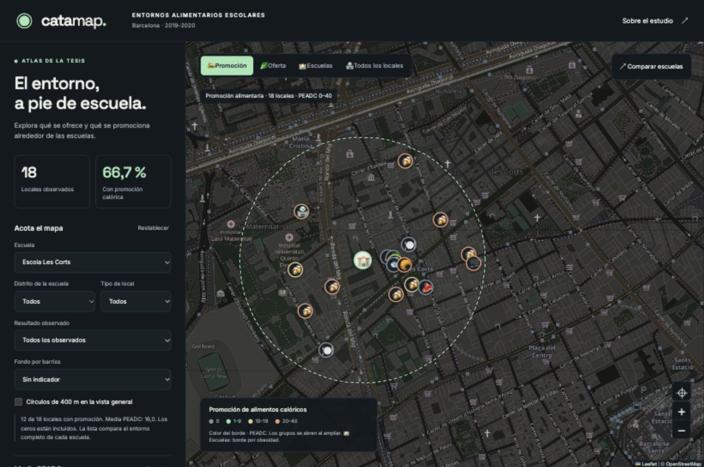

# Validación de la entrega

11 de octubre de 2026. Validación local; no se ha publicado en una cuenta remota.

- 17 pruebas del proceso de datos superadas; comprobación Ruff sin incidencias.
- 10 pruebas de filtros, muestras, nulos, clasificación publicada, agrupación,
  exportación CSV y exclusión de originales del paquete superadas.
- `npm run check:deploy`: construcción y simulación de despliegue completadas
  con Wrangler 4.149.0, con los assets de `dist/`.
- En el servidor local de Workers: aplicación y bundle responden 200;
  originales de la tesis responden 404; cabeceras y caché se aplican al bundle.
- Revisión del navegador en escritorio (1280 × 850) y móvil (375 × 812 y 450 × 827): selección de escuelas,
  círculos reconstruidos, ficha de local, vistas, filtros y contexto histórico.
- Verificados en pantalla: 306 observaciones PEADC, 76 con resultado cero,
  153 evaluaciones IDAS, 7 saludables según clasificación publicada,
  3.644 registros censales y 3.640 posiciones. Una selección vacía muestra
  «Sin dato», sin convertirla en una prevalencia de cero.
- El gráfico presenta 22 puntos y permite seleccionar una escuela con teclado.
  La ficha de Tres Pins conserva 0,01 % de exceso de peso y no transforma la
  falta de evaluaciones IDAS en un resultado nutricional.
- Sin errores de aplicación en la consola durante las comprobaciones.
- El generador CSV está probado. El navegador integrado no devolvió el evento
  de descarga en la comprobación; la recepción del archivo queda por confirmar
  en un navegador externo.

CARTO sin clave devolvía teselas con marca de agua. El fondo predeterminado
se cambió a OSM; CARTO Dark Matter permanece configurable. No se comprobó
CARTO con una clave de usuario ni el dominio final de Cloudflare.

